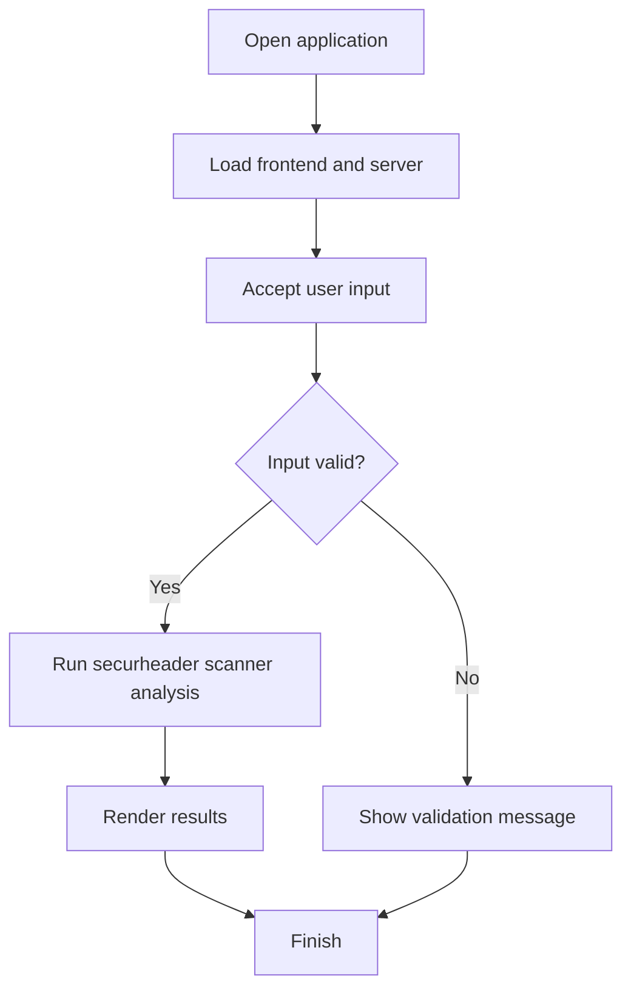

# 🔐 SecureHeader Scanner


## Get this repository

Clone the current project (this repository's canonical GitHub URL), then follow the installation and usage steps below.

```bash
git clone https://github.com/cyberworlduniversity/securheader-scanner.git
cd securheader-scanner
```

> HTTP Security Header Analyzer — Inspired by the [OWASP Secure Headers Project](https://owasp.org/www-project-secure-headers/)

---

## 📁 Project Files

```
securheader-scanner/
├── server.js        → Express backend (API + header analysis)
├── public/
│   └── index.html   → Frontend (HTML + CSS + JS)
├── package.json     → Dependencies & scripts
└── README.md        → This file
```

---

## 🚀 Quick Start

**1. Install dependencies**
```bash
npm install
```

**2. Start the server**
```bash
npm start
```

**3. Open in browser**
```
http://localhost:5000
```

---

## 🛡️ Headers Analyzed

| Header | Risk If Missing |
|---|---|
| Content-Security-Policy | 🔴 HIGH |
| Strict-Transport-Security (HSTS) | 🔴 HIGH |
| X-Frame-Options | 🟡 MEDIUM |
| X-Content-Type-Options | 🟡 MEDIUM |
| X-XSS-Protection | 🔵 LOW |
| Referrer-Policy | 🔵 LOW |
| Permissions-Policy | 🔵 LOW |
| Cross-Origin-Opener-Policy | 🔵 LOW |

---

## ✨ Features

- **URL Scanning** — Analyze any public website
- **Risk Level Badges** — HIGH / MEDIUM / LOW per header
- **Security Score** — Visual score ring (0–100%)
- **Fix Suggestions** — Exact header values to copy-paste
- **Expandable Cards** — Click any header for details

---

## 🔧 API

**POST** `/api/scan`

```json
Request:  { "url": "https://example.com" }

Response: {
  "url": "https://example.com",
  "statusCode": 200,
  "score": 62,
  "summary": { "secure": 5, "missing": 3, "total": 8 },
  "results": [ ... ]
}
```

---

## 🧰 Tech Stack

- **Backend** — Node.js + Express.js
- **Frontend** — Vanilla HTML, CSS, JavaScript
- **HTTP Client** — Axios

---

*Built by hemanathan115 • MIT License*


## Repository Quick Start

Clone the canonical repository:

```bash
git clone https://github.com/cyberworlduniversity/securheader-scanner.git
cd securheader-scanner
```

### Requirements and installation

- Node.js 18+

```bash
npm install
```

### Start the application

```bash
npm start
```

Open http://localhost:5000 in a browser.

### Build / validation

Check that dependencies install cleanly and that the application starts without runtime errors. No automated test script is currently declared in package.json.

Only scan websites you own or are explicitly authorized to assess.

### Application flow


